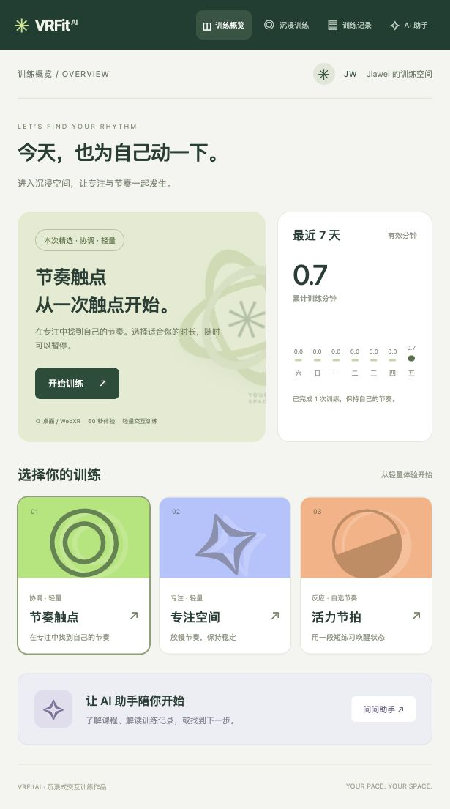

# VRFitAI · 沉浸式交互训练空间

Vue 3、Three.js / WebXR、Node.js 和 SQLite 构成的本地全栈作品。提供桌面／VR 触点训练、训练日志与可配置的 DeepSeek 兼容 AI 助手。



## 使用

需要 Node.js 22.13 或更新版本（本机验证版本 24.18）。

```sh
npm ci
cp .env.example .env
npm run build
npm start
```

打开 http://127.0.0.1:8780 。本机也可双击上一级的 `启动VR健身.command`。首次安装需要网络。日常运行只需 `npm start`；修改前端后重新构建。开发时同时运行 `npm start` 和 `npm run dev`，Vite 将 `/api` 转发给本机服务。

## 已实现的体验

- 三个触点课程：节奏、专注、活力，分别采用 4／6／2 秒目标轮换；命中后立即进入下一目标。
- 程序生成的三维健身空间、桌面旋转视角和点击目标、WebXR 双控制器射线、头显内状态与倒计时。
- 可选 30／60／120／300 秒，暂停／恢复／结束；离开训练页自动暂停，暂停时间不计入记录。
- SQLite 保存有效秒数、交互命中与桌面／VR 模式；幂等保存避免网络重试产生重复记录；历史、周视图和 CSV 导出。
- AI 对话、课程说明、可选的最近一次摘要；默认不传训练记录。聊天只保存在当前页面内存，刷新后清除。
- 训练过程尚未保存时刷新会丢失当前进度；已结束并成功保存的记录持久保存。

## DeepSeek／兼容 API

在本机 `.env` 中填写：

```dotenv
AI_API_KEY=你的密钥
AI_BASE_URL=https://api.deepseek.com
AI_MODEL=deepseek-flash
PORT=8780
HOST=127.0.0.1
```

密钥只由服务端读取，不使用 `VITE_` 前缀，不放入源码或聊天。也支持环境变量 `DEEPSEEK_API_KEY`。服务端向 `AI_BASE_URL + /chat/completions` 发送 OpenAI 风格请求；其他兼容服务按其文档填写含 `/v1` 的 base 和可用模型 ID。默认值依据 [DeepSeek 官方 API 文档](https://api-docs.deepseek.com/)；模型是否可用以账号当前服务为准。

配置后重启服务，在“AI 助手”发送课程问题即可验证。API 设有超时、输入限制、每 IP 每分钟 10 次限流和错误提示。`/api/health` 只表示密钥已配置，不表示供应商调用成功。界面明确显示缺密钥状态，不用预写回复冒充 AI。

本次接口测试使用模拟供应商验证协议、上下文与错误处理；**未配置真实密钥，因此尚未验证 DeepSeek 线上回答**。

## 结构与数据流

```text
src/App.vue                    页面、训练状态与接口请求
src/components/FitnessScene.vue Three.js 场景、鼠标与 WebXR 输入
src/session.js                 计时／暂停状态机
src/catalog.js                 课程目录
server/app.js                  API、校验、SQLite、CSV
server/assistant.js            兼容 API 适配与助手系统提示
server/index.js                本机服务入口
reference/                     上游出处（不转载参考组件）
```

浏览器 → 本机 `/api/sessions` → SQLite；浏览器 → 本机 `/api/chat` → 配置的 AI 提供商。只有主动发送的问题和勾选的摘要会发送给 AI 服务。数据库在 `data/vrfitai.sqlite`。项目按单人本机使用设计，没有用户账号或公开部署鉴权。

## VR 使用与验证边界

使用支持 WebXR 的头显浏览器，需要安全上下文：本机 localhost 或可信 HTTPS。桌面没有 VR 设备时会自动保留桌面模式，不显示假的“已连接”。控制器扳机触发发光球；紫色方块可开始／暂停／恢复。计时与状态文字位于三维场景内。

本次已验证桌面 WebGL、命中计数、暂停、保存、刷新、历史和缺密钥提示；没有可用头显，尚未实机验证 WebXR。它是交互训练原型，不包含人体姿势识别、真实卡路里估计、心率采集或医学建议，也没有 Unity 原生工程。

## 测试

```sh
npm test
npm run build
```

19 项测试覆盖训练状态机、SQLite 重启持久化、重复保存冲突、分页筛选、UTC 聚合边界、隐私日志、输入校验、对话角色限制、摘要选择、密钥缺失、协议请求、上游异常和限流。合成测试数据不表示用户训练效果。

## 数据与部署工程

历史页按 20 条分页加载，总次数／时长／命中由 SQLite 独立聚合，不受当前页数量影响。最近七天按 UTC 日期统计并补齐空白日期。`/api/session-page` 支持课程和模式筛选，单次最多 100 条；原 `/api/sessions` 数组接口保留用于兼容。

同一 UUID 的相同内容提交可安全重试，内容冲突返回 409。文件数据库启用 WAL 与 busy timeout，并为日期排序建立索引。请求响应含 `X-Request-ID`，服务入口输出不含问题正文或密钥的 JSON 日志。

Dockerfile、Compose 与自动化任务见 [部署说明](../DEPLOYMENT.md)。本次未运行 Docker 或远端 CI。

## 项目来源

本作品延续 VRFitAI 大创的主题，当前 WebXR 作品版完成于 2026-10。用户原项目贡献为三维交互负责人和网站主要开发者。这里提供的是当前重构的网页／WebXR 实现，不能当作找回的历史 Unity 源码，也不把本次新增 AI 接口回填为 2025 年已有功能。

场景生命周期和 WebXR 组织参考用户指定的 [Moeary/Vue_Ocean_Museum](https://github.com/Moeary/Vue_Ocean_Museum)。见 [来源说明](reference/NOTICE.md)。健身几何、训练状态、目标交互、记录后台和 AI 适配在本作品中实现。没有复制上游海洋馆大模型或 Gemini 密钥配置。
